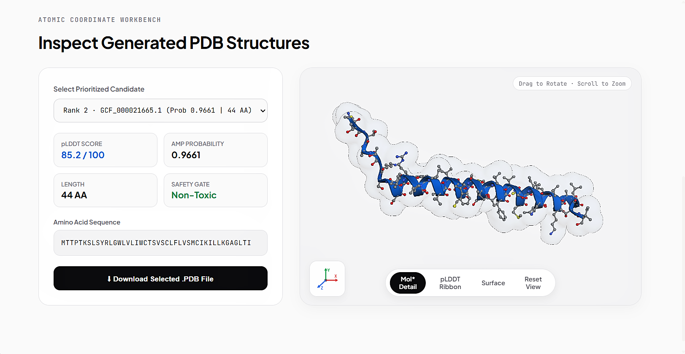

# Autonomous Extremophile AMP Bioprospecting Engine




An automated computational bioprospecting pipeline for mining, filtering, dereplicating, and structurally profiling novel antimicrobial peptides (AMPs) from extremophile genomic assemblies taken from NCBI database.

The pipeline combines ab initio smORF extraction, an orthogonal consensus prediction framework (Macrel Random Forest combined with a custom made RBF-kernel SVM), two-factor safety classification (hemolysis and mammalian cytotoxicity), sequence dereplication against the DRAMP database via local BLASTp, and a multi-parametric 100-point biophysical developability scoring system before submitting prioritized leads to Meta's ESMFold API for 3D atomic coordinate modeling.


## Overview & Methodology

Traditional AMP discovery is frequently confused by high false-positive rates from single-model predictors, synthesis failures due to poor solubility, or severe cytotoxicity against mammalian host cells. This pipeline addresses these limitations through a sequential 5-tier filtering architecture:

1. **smORF Calling & Cleaning:** Direct translation of small open reading frames ($\le 100\text{ AA}$) from whole-genome contigs using Pyrodigal, eliminating truncated fragments, enforcing a strict 10–100 AA length window, and discarding sequences with non-canonical residues (`B`, `Z`, `X`, `J`).
2. **Orthogonal Consensus Gating:** Sequences are simultaneously evaluated across two structurally independent classifiers—Macrel's 22-feature Random Forest model and an in-house Support Vector Machine trained on physicochemical descriptor vectors. Hits require dual-model agreement or single-model high-confidence consensus ($P \ge 0.70$).
3. **Safety & Host Liability Filtering:** Cleared AMP candidates pass through two independent SVM classifiers trained on validated experimental assays: an erythrocyte hemolysis model (ROC-AUC 0.962) and a mammalian cell cytotoxicity model (ROC-AUC 0.974). Any candidate with an predicted adverse liability ($P \ge 0.50$) is purged.
4. **Homology Dereplication:** Non-toxic candidates are cross-referenced against the curated DRAMP v3.0 database using local `blastp` ($E \le 10^{-3}$). Peptides with $\ge 40\%$ sequence identity to known entries are excluded, ensuring down-selected leads occupy uncharacterized chemical space.
5. **Developability Scoring & 3D Modeling:** Dereplicated novel leads are ranked using a 100-point composite scoring formula based on net formal charge, Eisenberg hydrophobic moment, Boman index, and solid-phase synthesis suitability. Atomic PDB structures and residue-level pLDDT confidence scores are generated for the top candidates via the Meta ESMFold API.


## Technical Specifications & Thresholds

| Pipeline Stage | Algorithm / Tool | Features / Input | Cutoff & Acceptance Criteria | Rationale |
| :--- | :--- | :--- | :--- | :--- |
| **smORF Calling** | Pyrodigal (v3.x) | Unannotated contigs | Length: 10 to 100 AA | Captures functional ribosomal peptides while excluding non-functional fragments and large proteins |
| **Consensus AMP** | Macrel (RF) + Custom SVM | Composition, charge, hydrophobic moments | Both predict AMP, or individual model $P \ge 0.70$ | Eliminates false-positive artifacts inherent to single ML architectures |
| **Hemolysis Gate** | Support Vector Machine (RBF) | AAC, DPC, physicochemical descriptors | $P_{\text{hemo}} < 0.50$ (Model ROC-AUC: 0.9625) | Prevents erythrocyte membrane rupture in downstream therapeutic applications |
| **Cytotoxicity Gate** | Support Vector Machine (RBF) | Eisenberg scales, net charge, residue polarity | $P_{\text{toxic}} < 0.50$ (Model ROC-AUC: 0.9740) | Selects against non-specific toxicity toward human and mammalian cell lines |
| **Dereplication** | NCBI `blastp` (v2.12+) | DRAMP v3.0 database ($E \le 10^{-3}$) | Sequence identity $< 40\%$ | Bypasses rediscovery of patent-saturated and heavily characterized peptide families |
| **3D Modeling** | Meta ESMFold API | Unaligned single-chain FASTA | Top 5 ranked leads | Predicts atomic coordinates without MSA generation; reports pLDDT confidence |


## 100-Point Biophysical Scoring Framework

Candidates that pass safety and dereplication gates are prioritized for synthesis using a 100-point developability framework:

* **Net Formal Charge at pH 7.4 (35 points):** Peptides with a net charge between $+2.0$ and $+6.0$ receive 35 points ($+1.0$ to $+2.0$ or $+6.0$ to $+8.0$ receive 20 points). Positive charge drives thermodynamic electrostatic attraction toward anionic bacterial outer envelopes (LPS, PG, cardiolipin) over zwitterionic mammalian membranes.
* **Eisenberg Hydrophobic Moment ($\langle \mu_H \rangle$) (35 points):** Values $\ge 0.35$ receive 35 points ($0.20$ to $0.35$ receive 20 points). Measures amphipathic segregation along the $\alpha$-helix, a requirement for self-assembly and membrane pore formation.
* **Boman Translocation Index (15 points):** Values between $-1.0$ and $+2.5\text{ kcal/mol}$ receive 15 points. Balances peptide-protein interaction potential, preventing non-specific sequestration by human serum albumin (HSA) in circulation.
* **SPPS Length Feasibility (15 points):** Sequences between 15 and 35 amino acids receive 15 points. Optimizes crude synthesis yields during Fmoc solid-phase peptide synthesis (SPPS) while preserving enough length to span a lipid bilayer.


## Requirements & Environment Setup

The pipeline requires Linux or Windows Subsystem for Linux (WSL2) with Miniconda or Anaconda:

```bash
# Clone the repository
git clone [https://github.com/your-username/extremophile-amp-mining.git](https://github.com/your-username/extremophile-amp-mining.git)
cd extremophile-amp-mining

# Create and activate conda environment from lockfile
conda env create -f environment.yml
conda activate amp_mining

# Install system-level BLAST+ binaries
sudo apt-get update && sudo apt-get install -y ncbi-blast+
```


## Quickstart

1. Place your input genomic FASTA files (`.fasta`, `.fna`) into the `contigs/` directory.
2. Execute the autonomous pipeline runner:

```bash
python master_amp_miner.py
```

3. Launch the interactive results dashboard and 3D molecular viewer:

```bash
streamlit run app.py
```


## Step-by-Step CLI Execution

Each script in the `scripts/` directory can be executed independently for modular debugging, parameter tuning, or re-scoring:

```bash
# Step 01: Extract translated small ORFs from genomic contigs
python scripts/01_extract_smorfs.py

# Step 02: Enforce 10-80 AA length cutoffs, purge non-canonical residues, and deduplicate
python scripts/02_validate_dedup.py

# Step 03: Run Macrel Random Forest classification
python scripts/03_run_macrel.py

# Step 04: Calculate physicochemical features and score via custom SVM
python scripts/04b_run_ampir_svm.py

# Step 05: Merge classifier predictions and compute consensus calls
python scripts/05_consensus_merge.py

# Step 06: Screen out hemolytic and cytotoxic liabilities
python scripts/06c_safety_filter.py

# Step 07: Perform local BLASTp against DRAMP v3.0 for novelty dereplication
python scripts/07_novelty_dereplication.py

# Step 08: Rank candidates via 100-pt biophysical scoring and fetch ESMFold PDBs
python scripts/08_fold_and_biophys.py
```


## Repository Structure

```
extremophile_amp_mining/
├── environment.yml                # Version-locked Conda environment specification
├── master_amp_miner.py            # Automated end-to-end master execution runner
├── app.py                         # Streamlit inspection dashboard with py3Dmol viewer
├── contigs/                       # Input extremophile assemblies (.fasta, .fna)
├── databases/                     # Reference training sets and indexed DRAMP BLAST database
├── models/                        # Pre-trained scikit-learn models (hemo_model, toxic_model)
├── scripts/                       # Modular pipeline stages 01 through 08
└── data/
    ├── 01_smorfs/                 # Extracted raw and deduplicated smORF pools
    ├── 02_classifications/        # Individual classifier predictions and consensus hits
    ├── 03_safety/                 # Filtered non-hemolytic and non-toxic candidate pools
    ├── 04_novelty/                # BLASTp dereplication reports and novel peptide subsets
    └── 05_final_leads/
        ├── prioritized_leads_report.tsv   # Comprehensive biophysical and pLDDT leaderboard
        ├── top_candidate_leads.faa        # Synthesis-ready FASTA file with metric headers
        └── pdbs/                          # ESMFold predicted 3D coordinate structures (.pdb)
```


## Deliverables & Downstream Usage

All finalized outputs are saved directly to `data/05_final_leads/`:

* **`prioritized_leads_report.tsv`**: Full evaluation dataset containing sequence identifiers, amino acid lengths, calculated formal charges (pH 7.4), mean hydrophobicities, Eisenberg hydrophobic moments ($\langle \mu_H \rangle$), Boman indices, ensemble consensus probabilities, composite priority scores, and mean backbone pLDDT values.
* **`top_candidate_leads.faa`**: FASTA file of the top 5 ranked sequences with complete biophysical metrics annotated directly in the header lines, formatted for commercial synthesis ordering.
* **`pdbs/`**: Atomic coordinate files (`rank1_*.pdb` through `rank5_*.pdb`) predicted by ESMFold, pre-formatted for secondary structure inspection, molecular dynamics (GROMACS/AMBER) simulations, or direct viewing in PyMOL, ChimeraX, and the bundled Streamlit dashboard.


## References & Attribution

This pipeline integrates open-source tools, machine learning architectures, and curated reference databases developed by the scientific community:

* **smORF Identification:** 
  * Larralde, M. (2022). *Pyrodigal: Python bindings to Prodigal for efficient gene prediction in metagenomic contigs.* Journal of Open Source Software, 7(72), 4296.
* **Peptide Classification:** 
  * Santos-Júnior, C. D., et al. (2020). *Macrel: antimicrobial peptide screening in (meta)genomes.* PeerJ, 8, e10555.
* **3D Structural Prediction:** 
  * Lin, Z., et al. (2023). *Evolutionary-scale prediction of atomic-level protein structure with a language model (ESM-2 / ESMFold).* Science, 379(6637), 1123–1130.
* **Homology Dereplication Database:** 
  * Kang, X., et al. (2019). *DRAMP 2.0, an updated comprehensive data repository of antimicrobial peptides with experimental evidence.* Scientific Data, 6, 148.
* **Sequence Alignment & Clustering:** 
  * Camacho, C., et al. (2009). *BLAST+: architecture and applications.* BMC Bioinformatics, 10, 421.
  * Fu, L., et al. (2012). *CD-HIT: accelerated for clustering the next-generation sequencing data.* Bioinformatics, 28(23), 3150–3152.
* **Biophysical Frameworks:** 
  * Eisenberg, D., Weiss, R. M., & Terwilliger, T. C. (1984). *The hydrophobic moment: detecting planar and cylindrical amphiphilicity in proteins.* PNAS, 81(1), 140–144.
  * Boman, H. G. (2003). *Antibacterial peptides: basic facts and emerging concepts.* Journal of Internal Medicine, 254(3), 197–215.
* **Visualization Engine:** 
  * Rego, N., & Koes, D. (2015). *3Dmol.js: molecular visualization without Java.* Bioinformatics, 31(8), 1322–1324.


## License

This project is released under the [MIT License](LICENSE). Third-party dependencies and databases remain subject to their respective original licenses.